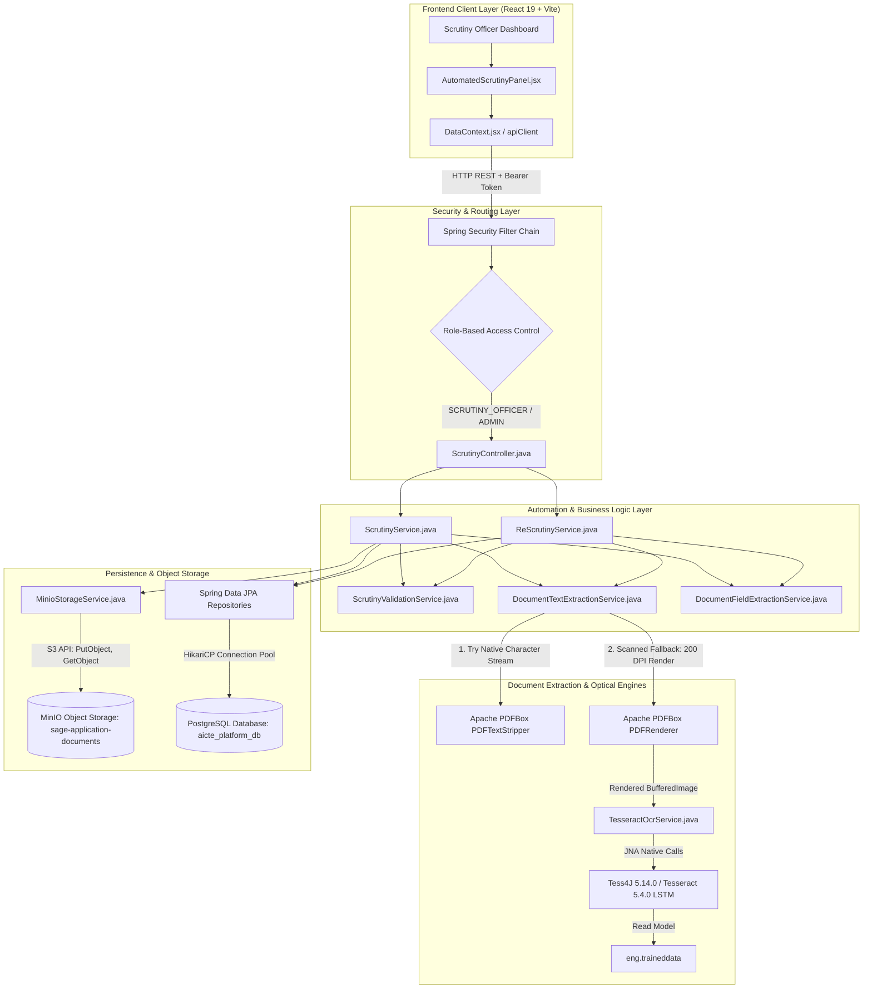
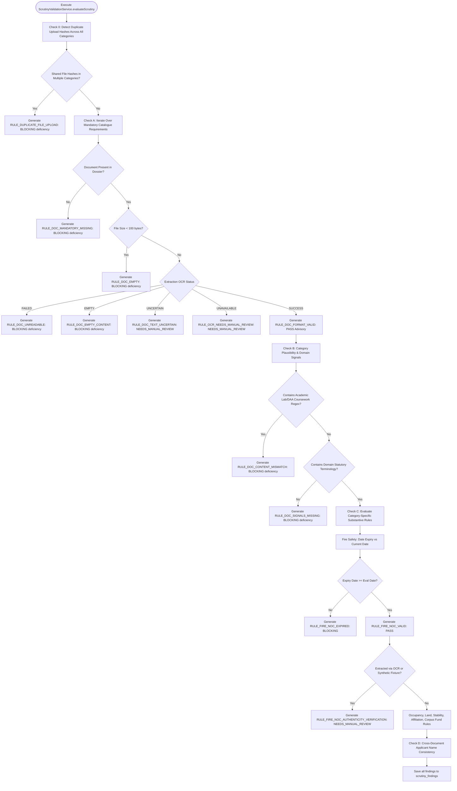
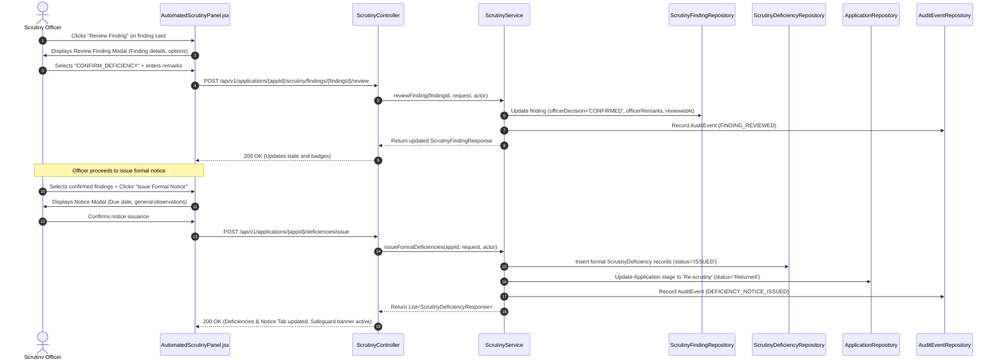
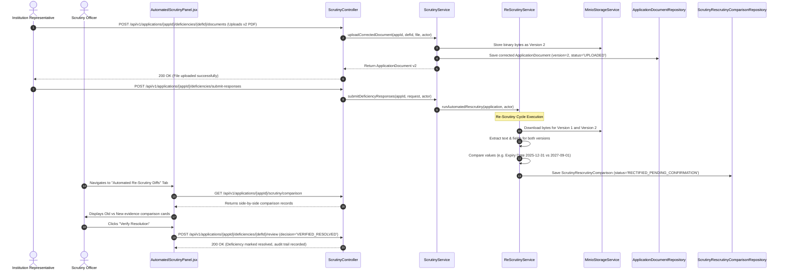

# SAGE Automated Scrutiny & Re-Scrutiny Engine — Architecture & Workflows

**Platform:** SAGE — Institutional Approval & Compliance Platform (SIH 26262)  
**File Location:** [`SCRUTINY_AUTOMATION_DOCUMENTATION/SCRUTINY_AUTOMATION_ARCHITECTURE.md`](file:///c:/Users/alone/Downloads/SIH2-Copy/SIH2/SCRUTINY_AUTOMATION_DOCUMENTATION/SCRUTINY_AUTOMATION_ARCHITECTURE.md)  
**Date:** October 28, 2026  

---

## 1. High-Level Component & System Architecture



---

## 2. Document Processing & OCR Fallback Workflow

This flowchart details how the dual-engine pipeline extracts text and distinguishes digital from scanned PDFs:

```mermaid
flowchart TD
    Start([Application Document Ingestion]) --> CheckBytes{Bytes null or empty?}
    CheckBytes -- Yes --> ReturnEmpty[Return ExtractedDocumentData: EMPTY_DOCUMENT, status: EMPTY]
    CheckBytes -- No --> CheckFormat{File Type / MIME PDF?}

    CheckFormat -- No Image File --> ImageOcr[extractFromImage: decode via ImageIO]
    ImageOcr --> ExecTessImage[TesseractOcrService.extractTextWithConfidence]
    ExecTessImage --> ReturnOcrImage[Return ExtractedDocumentData: TESSERACT_OCR_IMAGE]

    CheckFormat -- Yes PDF --> LoadPDF[PDDocument.load pdfBytes via Apache PDFBox]
    LoadPDF --> CheckPages{Page Count > 0?}
    CheckPages -- No --> ReturnZeroPages[Return ExtractedDocumentData: 0 Pages, status: EMPTY]

    CheckPages -- Yes --> Stripper[PDFTextStripper.getText: extract embedded text stream]
    Stripper --> CheckCharCount{Trimmed Text >= 40 chars?}

    CheckCharCount -- Yes: Digital PDF --> EmbedText[ExtractedDocumentData.embeddedText]
    EmbedText --> EmbedMetadata[ExtractionMethod: PDFBOX_SEARCHABLE_TEXT<br/>confidenceScore: NULL<br/>validationMetric: 'N/A (Embedded Text)']
    EmbedMetadata --> StructuredExtract[DocumentFieldExtractionService.extractStructuredFields]

    CheckCharCount -- No: Scanned / Blank --> CheckTessAvail{TesseractOcrService.isAvailable()?}
    CheckTessAvail -- No --> TessUnavailable[ExtractedDocumentData.unavailable: Native OCR engine not ready]
    TessUnavailable --> ManualFallback[Flag for Officer Manual Review: RULE_OCR_NEEDS_MANUAL_REVIEW]

    CheckTessAvail -- Yes --> RenderPages[PDFRenderer.renderImageWithDPI: 200 DPI up to 5 pages]
    RenderPages --> TessExec[TesseractOcrService.extractTextWithConfidence on each page]
    TessExec --> AggregateConf[Aggregate Word-Level Confidences via RIL_WORD]
    AggregateConf --> CheckOcrText{Total Recognized Chars > 0?}

    CheckOcrText -- No --> BlankScan[ExtractedDocumentData.empty: Blank or unreadable scan]
    BlankScan --> EmptyRule[Flag RULE_DOC_EMPTY_CONTENT as BLOCKING]

    CheckOcrText -- Yes --> ReturnOcrScanned[ExtractedDocumentData.ocr]
    ReturnOcrScanned --> OcrMetadata[ExtractionMethod: TESSERACT_OCR_SCANNED<br/>confidenceScore: e.g. 0.9537<br/>validationMetric: 'OCR_MEASURED (95.4%)']
    OcrMetadata --> StructuredExtract

    StructuredExtract --> PersistExtraction[(Save to scrutiny_document_extractions)]
```

---

## 3. Statutory Rule Engine & Deficiency Detection Flowchart



---

## 4. Scrutiny Officer Review & Formal Notice Sequence Diagram



---

## 5. Automated Re-Scrutiny & Evidence Comparison Workflow


