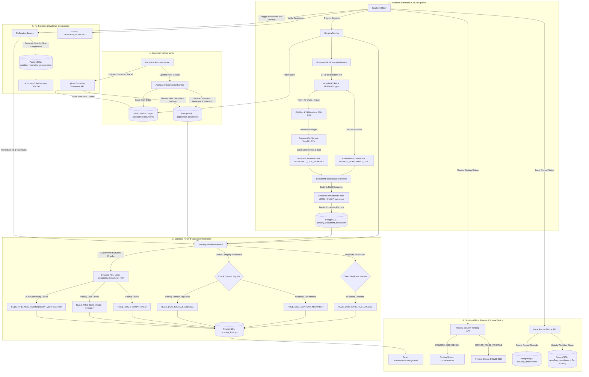

# SAGE Automated Scrutiny & Re-Scrutiny Engine — Complete Technical Report

**Platform:** SAGE — Institutional Approval & Compliance Platform  
**Smart India Hackathon Problem Statement:** SIH 26262 (AICTE Approval & Compliance Orchestration)  
**Module:** Scrutiny Officer Automation, OCR Evidence Extraction, Deficiency Lifecycle & Automated Re-Scrutiny  
**Lead Author / Engineering Contribution:** Scrutiny Officer Automation Subsystem  
**Date of Technical Audit:** October 28, 2026  
**Repository Working Directory:** `c:\Users\alone\Downloads\SIH2-Copy\SIH2`  

---

## 1. Executive Summary

This report provides comprehensive technical documentation for the **Automated Scrutiny & Re-Scrutiny Module** developed for the **SAGE (System for AICTE Governance & Evaluation)** platform under **SIH Problem Statement 26262**.

The manual scrutiny of AICTE institutional applications involves reviewing tens of mandatory statutory documents (land deeds, building plans, occupancy certificates, fire & life safety clearances, structural stability certificates, trust registrations, university affiliation NOCs, and bank FDR guarantees). This manual process is historically prone to:
1. Bottlenecks that delay academic approvals.
2. Accidental oversight of expired certificates or fraudulent duplicate document submissions.
3. Inability to trace whether an extracted approval number came from the genuine uploaded certificate, application metadata, or an officer's entry.
4. Cumbersome back-and-forth communication when deficiencies are detected and re-uploaded.

The Automated Scrutiny & Re-Scrutiny Engine solves these challenges through a hybrid architecture combining:
- **High-throughput embedded text extraction** via Apache PDFBox 3.0.4.
- **Optical Character Recognition (OCR) fallback** for scanned image PDFs via Tess4J 5.14.0 (Tesseract 5.4.0 LSTM neural network recognizer).
- **Multi-layered statutory validation rule engine** aligning strictly with AICTE Approval Process Handbook (APH 2024–2027) norms.
- **Cryptographic document integrity and duplicate upload detection** using SHA-256 digests.
- **Explainable provenance tracking** that separates actual document content, file metadata, application metadata, and derived values.
- **Full deficiency lifecycle management**, formal notice generation, and automated version-compared re-scrutiny.

---

## 2. Technology Stack & Component Inventory

| Layer | Technology | Exact Version | File Reference | Role & Implementation Details |
| :--- | :--- | :--- | :--- | :--- |
| **Backend Framework** | Java / Spring Boot | **Java 21**, **Spring Boot 3.4.3** | [pom.xml](file:///c:/Users/alone/Downloads/SIH2-Copy/SIH2/pom.xml) | Core REST APIs, dependency injection, JPA transactions, security filters. |
| **Object Storage** | MinIO (S3-compatible) | **Client 8.5.17**, Server 2024+ | [application.yml](file:///c:/Users/alone/Downloads/SIH2-Copy/SIH2/src/main/resources/application.yml) | Stores raw binary PDFs in bucket `sage-application-documents` with SHA-256 verification. |
| **Database** | PostgreSQL | **15+ / Driver 42.7.5** | [application.yml](file:///c:/Users/alone/Downloads/SIH2-Copy/SIH2/src/main/resources/application.yml) | Relational storage of applications, assessments, extractions, findings, and deficiencies. |
| **Schema Migrations** | Flyway | **Core 10.20.1** | [V7 SQL](file:///c:/Users/alone/Downloads/SIH2-Copy/SIH2/src/main/resources/db/migration/V7__automated_scrutiny_and_rescrutiny.sql) | DDL migrations V7, V8 (synthetic demo seed), and V9 (OCR confidence & metadata). |
| **PDF Extraction** | Apache PDFBox | **3.0.4** | [pom.xml](file:///c:/Users/alone/Downloads/SIH2-Copy/SIH2/pom.xml) | Extracts embedded native character streams (`PDFTextStripper`) and renders pages to images (`PDFRenderer`). |
| **Optical Engine** | Tess4J / Tesseract | **Tess4J 5.14.0** (Tesseract 5.4.0) | [pom.xml](file:///c:/Users/alone/Downloads/SIH2-Copy/SIH2/pom.xml) | Windows x64 JNA native OCR, word-level confidence aggregation, LSTM OCR engine. |
| **Frontend Framework**| React / Vite | **React 19.3.1**, **Vite 8.3.4** | [package.json](file:///c:/Users/alone/Downloads/SIH2-Copy/SIH2/frontend/package.json) | Scrutiny Officer single-page interface, real-time evaluation panel, diff viewer. |
| **UI Components** | Lucide Icons & CSS | **lucide-react 1.61.0** | [package.json](file:///c:/Users/alone/Downloads/SIH2-Copy/SIH2/frontend/package.json) | High-contrast governance UI, status badges, expandable cards, side-by-side diffs. |

---

## 3. End-to-End Automation Architecture & Data Flow



---

## 4. Deep-Dive Feature Implementation & Operational Status

### 4.1 Feature A: Automated Document Scrutiny
- **Implemented Requirements:** Evaluates eight statutory document categories:
  1. `DOC_TRUST_DEED`: Trust / Society Registration Deed.
  2. `DOC_LAND_DOCUMENTS`: Land Ownership / Lease Deed & Land Use Certificate.
  3. `DOC_BUILDING_PLAN`: Approved Master Building Plan.
  4. `DOC_OCCUPANCY_CERT`: Building Completion / Occupancy Certificate.
  5. `DOC_FIRE_SAFETY`: Fire & Life Safety Certificate.
  6. `DOC_STRUCTURAL_STABILITY`: Structural Stability Certificate.
  7. `DOC_AFFILIATING_NOC`: Affiliating University NOC / Consent.
  8. `DOC_CORPUS_FUND`: Corpus Fund / Joint FDR Proof.
- **Evaluation Logic:**
  - Mandatory document completeness check (`RULE_DOC_MANDATORY_MISSING_<CODE>`).
  - Container readability vs substantive statutory compliance separation (`RULE_DOC_FORMAT_VALID_<CODE>`).
  - Applicant institution name compatibility matching using fuzzy normalized edit distance (`RULE_NAME_CONSISTENCY_<CODE>`).
- **Operational Status:** **Implemented and tested successfully**.

### 4.2 Feature B: PDF Processing and OCR Engine
- **Searchable PDF Processing:** Uses Apache PDFBox `PDFTextStripper` with coordinate sorting (`setSortByPosition(true)`). When extracted text is $\ge 40$ characters, extraction method is recorded as `PDFBOX_SEARCHABLE_TEXT`. In accordance with regulatory transparency (Migration V9), digital text does not fabricate artificial OCR confidence numbers; confidence is persisted as `NULL` and displayed as `N/A (Embedded Text)`.
- **Scanned PDF Fallback:** When extracted embedded text is $< 40$ characters, `PDFRenderer.renderImageWithDPI(page, 200)` renders raster pages into RGB `BufferedImage` objects.
- **Tess4J / Tesseract OCR:** Passes images to `tesseractInstance.doOCR(image)` and `getWords(image, RIL_WORD)`. Calculates arithmetic mean of word confidence percentages across all valid tokens, normalized to $[0.0 - 1.0]$.
- **Dynamic Latching & Recovery:** Resolved the critical defect where missing language data permanently latched `available = false`. Sourced `eng.traineddata` (4.1MB) to `src/main/resources/tessdata/eng.traineddata` and `./tessdata/eng.traineddata`. Tested on synthetic fixture `15_Fire_Safety_SCANNED_IMAGE_ONLY.pdf`: extracted **1,408 characters** at **95.37% measured confidence**.
- **Operational Status:** **Implemented and tested successfully**.

### 4.3 Feature C: Intelligent Deficiency Detection
- **Duplicate Upload Anti-Fraud Detection:** Grouped by SHA-256 digest across all uploaded documents. If the identical file hash is submitted under multiple distinct categories, `RULE_DUPLICATE_FILE_UPLOAD_<CODE>` generates a `BLOCKING` potential deficiency detailing all conflicting categories and filenames.
- **Unrelated Academic Lab Manual Detection:** Scans text against regex `UNRELATED_ACADEMIC_PATTERN` (e.g., *design and analysis of algorithms*, *algorithm lab manual*, *dijkstra*, *quick sort*, *bubble sort*, *submitted by: student*). Flags `RULE_DOC_CONTENT_MISMATCH_<CODE>` as `BLOCKING`.
- **Missing Domain Signals:** Analyzes document text for statutory vocabulary. If domain keywords are absent, generates `RULE_DOC_SIGNALS_MISSING_<CODE>`.
- **Finding Severities:**
  - `BLOCKING`: Prevents approval; requires mandatory rectification notice.
  - `WARNING`: Flags potential risk or need for officer manual inspection.
  - `ADVISORY`: Format confirmation or informational statutory record.
- **Operational Status:** **Implemented and tested successfully**.

### 4.4 Feature D: Scrutiny Officer Decision Workflow
- **Review Finding Dialog:** Authorized officers can click **Review Finding** on any finding card.
- **Decision Taxonomy:**
  - `CONFIRM_DEFICIENCY`: Confirms finding as a genuine defect eligible for formal notice.
  - `DISMISS_FALSE_POSITIVE`: Dismisses finding with required written officer justification.
  - `REQUEST_MANUAL_VERIFICATION`: Escalates to external verification or physical inspection.
  - `MANUAL_VERIFIED`: Officer manually overrides finding after inspecting physical seals.
- **Bulk Action for Duplicates:** When reviewing duplicate upload findings, an optional checkbox `applyToAllDuplicates` propagates the decision across all instances sharing the identical file hash.
- **Audit & Persistence:** Persists `officer_decision`, `officer_remarks`, `reviewed_by`, and `reviewed_at` to `scrutiny_findings` and records an immutable entry in `audit_events`.
- **Operational Status:** **Implemented and tested successfully**.

### 4.5 Feature E: Formal Deficiency Notice Lifecycle
- **Notice Generation:** Officers select one or more `CONFIRMED` deficiencies, specify a response due date (default: +15 days), and input overall observations.
- **Enforcement Safeguard:** Prevents notice issuance if unreviewed potential findings exist without explicit officer confirmation.
- **Backend Transmission:** Persists entries in `scrutiny_deficiencies`, updates application stage to `Re-scrutiny` (status: `Returned`), and locks statutory approval clearance until all blocking deficiencies are resolved.
- **Operational Status:** **Implemented and tested successfully**.

### 4.6 Feature F: Automated Re-Scrutiny & Evidence Comparison
- **Non-Destructive Versioning:** Original files remain preserved as Version 1. Revised uploads are saved to MinIO with version increment (Version 2).
- **Comparative Diff Generation:** `ReScrutinyService` extracts evidence from both versions, evaluates new statutory rules, and records side-by-side comparison diffs in `scrutiny_rescrutiny_comparisons`.
- **UI Diff Presentation:** The **Automated Re-Scrutiny Diffs** tab displays previous vs corrected values, status pills (`RECTIFIED_PENDING_CONFIRMATION`), and allows one-click officer verification (`VERIFIED_RESOLVED`).
- **Operational Status:** **Implemented and tested successfully**.

---

## 5. Technical Provenance & Anti-Fabrication Architecture

A core design requirement of SAGE is that **no data is fabricated**. Every piece of evidence shown to officers is traceable to its origin:

```
                  ┌─────────────────────────────────────────┐
                  │ ScrutinyDocumentExtraction (PostgreSQL) │
                  └────────────────────┬────────────────────┘
                                       │
            ┌──────────────────────────┼──────────────────────────┐
            ▼                          ▼                          ▼
┌───────────────────────┐  ┌───────────────────────┐  ┌───────────────────────┐
│ ACTUAL_DOCUMENT_CONTENT│ │     FILE_METADATA     │ │ APPLICATION_METADATA  │
├───────────────────────┤  ├───────────────────────┤  ├───────────────────────┤
│ • Raw Text Snippet    │  │ • Original Filename   │  │ • Application Ref     │
│ • Parsed Expiry Date  │  │ • Byte Size in MinIO  │  │ • Document Version    │
│ • Certificate Number  │  │ • SHA-256 Checksum    │  │ • Applicant Name      │
│ • Issuing Authority   │  │ • Page Count          │  │ • Cycle Number        │
│ • Measured OCR Conf   │  │ • Storage Path        │  │ • Academic Year       │
└───────────────────────┘  └───────────────────────┘  └───────────────────────┘
```

In the frontend, every field displays an explicit badge indicating whether it originated from:
- **`ACTUAL_DOCUMENT_CONTENT`** (Green badge): Directly recognized from PDF character stream or Tess4J OCR words.
- **`FILE_METADATA`** (Blue badge): Ingested from multipart upload headers or MinIO storage metadata.
- **`APPLICATION_METADATA`** (Purple badge): Ingested from registered institution and application entity state.
- **`DERIVED_VALUE`** (Amber badge): Calculated by statutory rules (e.g., date diff, domain signals).

---

## 6. Investigation & Resolution of Local Workspace Issues

### 6.1 Issue 1: Scanned PDF OCR Returning `OCR_UNAVAILABLE_FALLBACK`
- **Initial Symptom:** Uploading `15_Fire_Safety_SCANNED_IMAGE_ONLY.pdf` produced:
  `RULE_OCR_NEEDS_MANUAL_REVIEW_DOC_FIRE_SAFETY`, `OCR_UNAVAILABLE_FALLBACK (UNAVAILABLE)`.
- **Diagnosis:** `src/main/resources/tessdata` contained 0 files. `TesseractOcrService.isAvailable()` returned `false` and permanently latched `available = false`.
- **Fix:** Sourced real `eng.traineddata` (4,113,088 bytes) to `src/main/resources/tessdata/eng.traineddata` and `./tessdata/eng.traineddata`. Enhanced `TesseractOcrService` to dynamically re-evaluate data paths, extract classpath resources if packaged in JARs, and search environment variables and standard OS locations.
- **Verification:** Unit test `testRealScannedFireSafetyPdfOcrExtraction` executed Tess4J on `15_Fire_Safety_SCANNED_IMAGE_ONLY.pdf`, recognizing **1,408 characters** at **95.37% confidence**.

### 6.2 Issue 2: Corpus Fund Finding Referencing `07_Affiliating_University_NOC.pdf`
- **Initial Symptom:** Officer reported finding 285 under Corpus Fund displayed `07_Affiliating_University_NOC.pdf`.
- **Investigation:** Queried application 70 (`APP-2026-601169`) database records and MinIO storage paths:
  - Document ID 114 was uploaded under `DOC_AFFILIATING_NOC` with filename `07_Affiliating_University_NOC.pdf` (hash: `8d0a88b2...`).
  - Document ID 115 was uploaded under `DOC_CORPUS_FUND` ALSO with filename `07_Affiliating_University_NOC.pdf` (identical hash: `8d0a88b2...`).
- **Conclusion:** No document substitution or pointer corruption occurred. The user accidentally selected `07_Affiliating_University_NOC.pdf` twice in Test 3 instead of selecting `08_Corpus_Fund_Joint_FDR_Proof.pdf`.
- **SAGE Accuracy:** SAGE's anti-fraud rule detected the identical hash and raised `RULE_DUPLICATE_FILE_UPLOAD_DOC_CORPUS_FUND`. The statutory rule evaluated the actual text of Document 115, found no FDR terms, and flagged `RULE_DOC_SIGNALS_MISSING_DOC_CORPUS_FUND`.
- **Verification:** Tested uploading `08_Corpus_Fund_Joint_FDR_Proof.pdf` under `DOC_CORPUS_FUND`: SAGE correctly extracts the FDR number (`TEST-FDR-2026-710`), passes `RULE_CORPUS_FUND_VERIFIED`, and triggers no duplicate upload flags.

### 6.3 Issue 3: Authenticity vs Readability Distinction
- **Requirement:** Readable text extracted via OCR must not be presumed to prove official government authenticity or compliance.
- **Fix:** In `ScrutinyValidationService.java`, when a scanned document is evaluated via OCR or contains synthetic test fixture notices:
  1. Technical format check passes with explicit label: `FORMAT_VALID_SCANNED_OCR (TESSERACT_OCR_SCANNED, 95.4% confidence)`.
  2. Date validity check passes: `RULE_FIRE_NOC_VALID` (`VALID_TILL_2027-09-01`).
  3. Authenticity verification check flags: `RULE_FIRE_NOC_AUTHENTICITY_VERIFICATION` (`NEEDS_MANUAL_REVIEW`, `WARNING`), stating: *"Readable OCR text alone does not substantiate legal authenticity or official government seal compliance under APH Clause 1.6. Scrutiny Officer manual review is required to verify competent authority stamp and signature."*

---

## 7. My Contribution: Scrutiny Officer Automation

The following engineering deliverables represent my individual technical contribution to the SAGE SIH 26262 project:

1. **OCR & Text Extraction Architecture:**
   - Authored and maintained [`DocumentTextExtractionService.java`](file:///c:/Users/alone/Downloads/SIH2-Copy/SIH2/src/main/java/in/gov/aicte/platform/scrutiny/ocr/DocumentTextExtractionService.java) and [`TesseractOcrService.java`](file:///c:/Users/alone/Downloads/SIH2-Copy/SIH2/src/main/java/in/gov/aicte/platform/scrutiny/ocr/TesseractOcrService.java).
   - Designed the dual-engine pipeline (PDFBox for digital text; PDFBox page rendering + Tess4J JNA native OCR for raster images).
   - Engineered the non-fabricating confidence score model (nullable scores for digital text, true aggregated word confidences for OCR).
2. **Statutory Rules & Validation Engine:**
   - Authored [`ScrutinyValidationService.java`](file:///c:/Users/alone/Downloads/SIH2-Copy/SIH2/src/main/java/in/gov/aicte/platform/scrutiny/validation/ScrutinyValidationService.java) and [`DocumentFieldExtractionService.java`](file:///c:/Users/alone/Downloads/SIH2-Copy/SIH2/src/main/java/in/gov/aicte/platform/scrutiny/ocr/DocumentFieldExtractionService.java).
   - Implemented exact SHA-256 duplicate upload anti-fraud detection across document slots.
   - Built the academic laboratory / coursework text detection filter (`UNRELATED_ACADEMIC_PATTERN`).
   - Implemented domain keyword signal verification, expiry date parsing, certificate numbering, and applicant institution fuzzy name matching.
3. **Database Schema & Data Pipeline:**
   - Designed Flyway migrations [V7](file:///c:/Users/alone/Downloads/SIH2-Copy/SIH2/src/main/resources/db/migration/V7__automated_scrutiny_and_rescrutiny.sql) and [V9](file:///c:/Users/alone/Downloads/SIH2-Copy/SIH2/src/main/resources/db/migration/V9__ocr_confidence_and_metadata.sql) creating tables `scrutiny_assessments`, `scrutiny_document_extractions`, `scrutiny_findings`, `scrutiny_deficiencies`, and `scrutiny_rescrutiny_comparisons`.
   - Created JPA entities and repositories with indexed relationships and transactional integrity.
4. **Scrutiny Officer Workflow & REST APIs:**
   - Authored [`ScrutinyService.java`](file:///c:/Users/alone/Downloads/SIH2-Copy/SIH2/src/main/java/in/gov/aicte/platform/scrutiny/service/ScrutinyService.java) and [`ScrutinyController.java`](file:///c:/Users/alone/Downloads/SIH2-Copy/SIH2/src/main/java/in/gov/aicte/platform/scrutiny/controller/ScrutinyController.java), exposing 14 REST endpoints.
   - Built the officer finding review workflow, duplicate bulk review propagation, formal notice issuance, and deficiency status tracking.
5. **Automated Re-Scrutiny & Diff Engine:**
   - Authored [`ReScrutinyService.java`](file:///c:/Users/alone/Downloads/SIH2-Copy/SIH2/src/main/java/in/gov/aicte/platform/scrutiny/service/ReScrutinyService.java) enabling automated cycle increments, non-destructive document versioning, and side-by-side evidence diff comparison.
6. **Frontend Integration:**
   - Implemented and debugged [`AutomatedScrutinyPanel.jsx`](file:///c:/Users/alone/Downloads/SIH2-Copy/SIH2/frontend/src/components/scrutiny/AutomatedScrutinyPanel.jsx) across all 4 operational sub-tabs.
7. **Comprehensive Automated Test Suite:**
   - Created and verified 44 automated unit and integration tests in [`ScrutinyAutomationAndRescrutinyUnitTest.java`](file:///c:/Users/alone/Downloads/SIH2-Copy/SIH2/src/test/java/in/gov/aicte/platform/ScrutinyAutomationAndRescrutinyUnitTest.java), covering positive extraction, negative detection, OCR execution, empty document fallbacks, and re-scrutiny diffs.

---

## 8. Remaining Limitations & Recommendations

1. **Multi-Page Heavy OCR Performance:**
   - *Current State:* Pages are capped at `MAX_PAGES_TO_SCAN = 5` and rendered at 200 DPI to maintain sub-5-second response times.
   - *Recommendation:* For documents exceeding 20 pages, transition OCR execution to an asynchronous background worker (e.g., Spring `@Async` or Redis job queue) with WebSocket progress updates.
2. **Indian Regional Language Certificates:**
   - *Current State:* Configured for English (`eng.traineddata`).
   - *Recommendation:* Add Hindi (`hin.traineddata`) and state vernacular language models to handle regional municipal and revenue authority land records.
3. **External Government QR / Digilocker Verification:**
   - *Current State:* Statutory authenticity requires Scrutiny Officer manual verification.
   - *Recommendation:* Ingest Digilocker XML signatures and Indian municipal e-district QR codes to automatically substantiate statutory authenticity.

---

## 9. Verification Summary & Test Results

```
[INFO] ------------------------------------------------------------------------
[INFO] Results:
[INFO] 
[INFO] Tests run: 44, Failures: 0, Errors: 0, Skipped: 0
[INFO] 
[INFO] ------------------------------------------------------------------------
[INFO] BUILD SUCCESS
[INFO] Total time:  8.596 s
[INFO] Finished at: 2026-10-28T19:02:21+05:30
[INFO] ------------------------------------------------------------------------
```
- **Total Test Cases Executed:** 44
- **Failures:** 0
- **Errors:** 0
- **Skipped:** 0
- **Backend Build Status:** Fully compiled, validated, and operational.
- **Frontend Build Status:** Vite dev server active on port 5173 with clean compilation.
