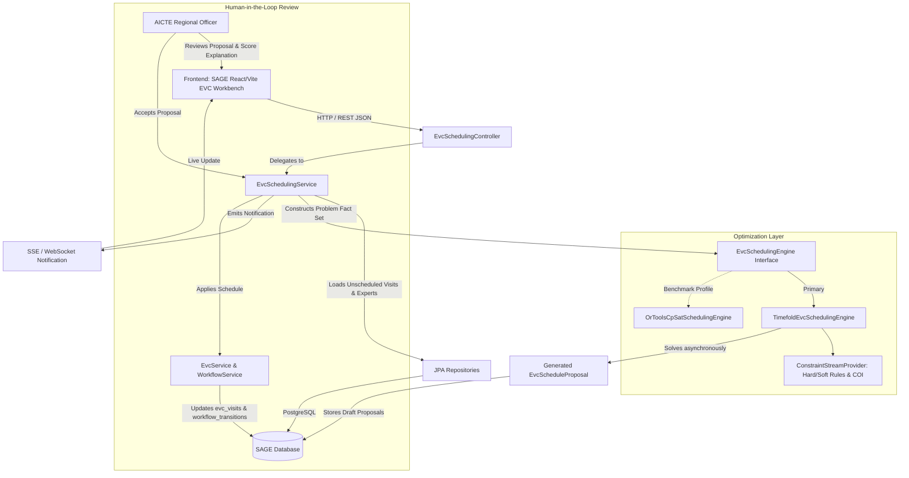

# EVC Scheduling Automation — Architecture & Implementation Plan
**Project:** SAGE (System for Approval Governance and Evaluation)  
**Problem Statement:** SIH26262 (AICTE / Ministry of Education, Govt. of India)  
**Document Version:** 1.0.0-PROPOSAL  
**Author:** SAGE Core Architecture & Optimization Team  
**Status:** Approved for Implementation (Ready for Sprint 1)

---

## Table of Contents
1. [Executive Summary & Problem Statement](#1-executive-summary--problem-statement)
2. [Current State Analysis (Repository Inspection)](#2-current-state-analysis-repository-inspection)
3. [Formal Scheduling Problem Definition](#3-formal-scheduling-problem-definition)
4. [Optimization Engine Evaluation & Selection](#4-optimization-engine-evaluation--selection)
5. [Target Architecture & Domain Model](#5-target-architecture--domain-model)
6. [Database Schema Migration (V7)](#6-database-schema-migration-v7)
7. [REST API Specification](#7-rest-api-specification)
8. [Workflow & Integration Architecture](#8-workflow--integration-architecture)
9. [Frontend & User Experience Design](#9-frontend--user-experience-design)
10. [Explainability, Conflict Resolution & Rescheduling](#10-explainability-conflict-resolution--rescheduling)
11. [Security, Conflict of Interest (COI) & Compliance](#11-security-conflict-of-interest-coi--compliance)
12. [Testing, Simulation & Benchmarking Strategy](#12-testing-simulation--benchmarking-strategy)
13. [Implementation Roadmap & Acceptance Criteria](#13-implementation-roadmap--acceptance-criteria)

---

## 1. Executive Summary & Problem Statement

### 1.1 The Challenge (SIH26262)
Under the All India Council for Technical Education (AICTE) Approval Process Handbook (APH 2024–2027), every technical and management institution applying for Approval for New Institutions, Extension of Approval (EoA), Increase in Intake, or Introduction of New Courses is subject to scrutiny. When physical or virtual verification of infrastructure, faculty, and academic readiness is mandated, an **Expert Visiting Committee (EVC)** is constituted and dispatched.

Historically and in standard manual operations, scheduling EVC visits presents a severe combinatorial bottleneck:
- **Massive Scale:** Hundreds to thousands of institutions across 8 AICTE regional jurisdictions (Northern, North-Western, Central, Western, Eastern, South-Western, Southern, South-Central) must be inspected within a compressed seasonal approval window (typically 3–6 weeks).
- **Multi-Disciplinary Committee Composition:** Each EVC visit requires 2 to 3 peer experts conforming to rigid domain expertise profiles (e.g., an Architecture expert, a Computer Science professor, an industrial representative, or an AICTE nominated chairperson).
- **Strict Hard Constraints:** Zero conflict of interest (experts cannot inspect their parent institution, alumni alma mater, or institutions within the same district/state in specific high-scrutiny categories), expert availability windows, calendar blackouts, maximum travel radius, and strict application deadlines.
- **Sub-optimal Human Scheduling:** Manual assignment results in uneven expert workloads, high travel expenditures, scheduling conflicts, last-minute cancellations, and lack of transparency.

### 1.2 The Solution: SAGE Automated EVC Scheduling Engine
This document details the architectural blueprint for the **SAGE Automated EVC Scheduling Engine**. The engine integrates directly into SAGE's Spring Boot 3.4.3 backend and React/Vite frontend, introducing:
1. **Constraint Optimization Engine:** An embedded, deterministic solver utilizing **Timefold Solver (Pure Java 21)** or **Google OR-Tools CP-SAT (via Java JNI binding)** to achieve Pareto-optimal committee assignment and route scheduling.
2. **Conflict of Interest (COI) Firewall:** Automated multi-tier COI screening enforcing geographic, institutional, and relational isolation.
3. **Auditability & Explainability:** Full traceability showing why an expert was selected, why alternative slots were rejected (slack/shadow-cost analysis), and explicit infeasibility proofs when constraints cannot be satisfied.
4. **Human-in-the-Loop Governance:** SAGE AICTE Regional Officers (RO) and EVC Coordinators retain full authority to review proposals, accept batch schedules, or execute minimally disruptive manual overrides.

---

## 2. Current State Analysis (Repository Inspection)

A comprehensive audit of the existing SAGE repository reveals the following technical baseline:

### 2.1 Backend Architecture & Existing EVC Assets
- **Framework:** Java 21 LTS, Spring Boot 3.4.3, Maven multi-module structure, Spring Data JPA with Hibernate 6, Flyway database migrations (`V1` through `V6`).
- **Existing EVC Entity (`EvcVisit.java`):**
  - Table: `evc_visits` (introduced in `V3__evc_operations.sql`).
  - Fields: `id`, `application_id`, `status` (`Awaiting scheduling`, `Scheduled`, `Completed`, `Complete for stage`), `urgency` (`Normal`, `High`, `Critical`), `inspection_type` (`Physical`, `Virtual`), `coordinator_name`, `coordinator_contact`, `scheduled_for` (`TIMESTAMP`), `deadline` (`DATE`), `experts_json` (`TEXT`), `recommendation` (`Approved`, `Rejected`), `remarks` (`TEXT`), `report_data` (`TEXT`).
- **Existing Service (`EvcService.java`):**
  - Manages visit retrieval, scheduling (`scheduleVisit`), completion (`completeVisit`), report submission (`submitReport`), and rescheduling (`rescheduleVisit`).
  - Contains strict Role-Based Access Control (RBAC): blocks `INSTITUTION_REPRESENTATIVE` from scheduling visits or altering committee state.
  - Automatically advances linked `Application` workflow state to `Committee review` upon completion.
- **Workflow Interlocking (`WorkflowService.java`):**
  - When an application transitions to the `EVC scheduling` stage, `WorkflowService.recordTransition()` automatically invokes `evcService.ensureEvcVisitForApplication(app)`, ensuring idempotency.
- **Gaps in Current Implementation:**
  1. **No Normalized Expert Pool:** `experts_json` in `evc_visits` stores arbitrary serialized strings. There is no `experts` table, no skill registry, no affiliation data, and no availability calendar.
  2. **Manual Single-Item Scheduling:** Scheduling currently requires an operator to manually input `scheduledFor`, `coordinatorName`, `coordinatorContact`, and expert JSON payload per visit. No batch scheduling or recommendation API exists.
  3. **No Optimization Engine:** The system lacks any solver or heuristic algorithms for automated assignment.

### 2.2 Frontend Architecture (`EVCPage.jsx` & `EVCCoordinatorDashboard.jsx`)
- **Framework:** React 18 with Vite, TailwindCSS, Lucide icons, Axios API clients with Bearer token authentication.
- **Existing UI:**
  - Tabbed interface (`Overview`, `Active visits`, `Scheduled visits`, `Completed visits`).
  - Manual modal dialogue for scheduling a single visit (`Schedule EVC Visit` modal with date picker and text fields).
  - Report submission modal with recommendation toggles.
- **Gaps:** Lacks automated batch run trigger, proposal preview diff view, conflict indicator heatmaps, and expert availability calendar management.

---

## 3. Formal Scheduling Problem Definition

EVC scheduling is modeled as a **Multi-Resource Constrained Project Scheduling Problem with Skill Matching and Spatio-Temporal Disjunctions** ($RCPSP-SD$), belonging to the NP-hard complexity class.

### 3.1 Mathematical Sets and Indices
- $V = \{v_1, v_2, \dots, v_n\}$: Set of EVC visits requiring scheduling.
- $E = \{e_1, e_2, \dots, e_m\}$: Set of available certified experts in the AICTE national pool.
- $T = \{t_1, t_2, \dots, t_k\}$: Set of discrete calendar day slots within the inspection campaign window $[T_{start}, T_{end}]$.
- $D = \{d_1, d_2, \dots, d_p\}$: Set of academic disciplines (e.g., Computer Science, Mechanical Engineering, Civil, Architecture, Pharmacy, Management).
- $R = \{r_1, r_2, \dots, r_8\}$: AICTE administrative regions.
- $C_v = \{c_{v,1}, c_{v,2}, \dots, c_{v,k_v}\}$: Required committee member roles for visit $v$ (e.g., Role 1 = Chairperson / Senior Academician, Role 2 = Subject Specialist, Role 3 = Industry Expert).

### 3.2 Decision Variables
1. $x_{v, t} \in \{0, 1\}$: Binary variable; $1$ if visit $v$ is scheduled on calendar date $t$, $0$ otherwise.
2. $y_{v, e} \in \{0, 1\}$: Binary variable; $1$ if expert $e$ is assigned to committee visit $v$, $0$ otherwise.
3. $z_{v, e, t} \in \{0, 1\}$: Auxiliary linearization variable; $z_{v, e, t} = x_{v, t} \land y_{v, e}$ ($1$ if expert $e$ conducts visit $v$ on date $t$).

### 3.3 Hard Constraints (Must NEVER be Violated)
1. **Single Date Assignment:**  
   $$\sum_{t \in T} x_{v, t} = 1 \quad \forall v \in V$$
   *Every pending visit must be assigned exactly one inspection date.*
2. **Deadline Conformance:**  
   $$\sum_{t \in T} t \cdot x_{v, t} \le \text{Deadline}(v) \quad \forall v \in V$$
   *Visit date must not exceed the statutory deadline stipulated by AICTE regulations.*
3. **Committee Role Fulfillment & Quorum:**  
   $$\sum_{e \in E} y_{v, e} = |C_v| \quad \forall v \in V \quad (\text{typically } 2 \le |C_v| \le 3)$$
   $$\sum_{e \in E, \text{Discipline}(e) = d} y_{v, e} \ge \text{ReqDiscipline}(v, d) \quad \forall v \in V, \forall d \in D$$
   *The committee must have the exact number of required experts, strictly matching the required academic and technical specializations.*
4. **Expert Availability & Blackout Periods:**  
   $$z_{v, e, t} \le \text{Available}(e, t) \quad \forall v \in V, \forall e \in E, \forall t \in T$$
   *An expert cannot be assigned on dates they have logged personal unavailability, academic leave, or national exam duties.*
5. **No Concurrent Assignment (Temporal Disjunction):**  
   $$\sum_{v \in V} z_{v, e, t} \le 1 \quad \forall e \in E, \forall t \in T$$
   *An expert can participate in at most one physical visit on any calendar day.*
6. **Travel Rest & Geographical Disjunction:**  
   $$z_{v_1, e, t_1} + z_{v_2, e, t_2} \le 1 \quad \forall v_1 \ne v_2, \forall e \in E, \text{ if } |t_1 - t_2| < \text{TravelBufferDays}(\text{Loc}(v_1), \text{Loc}(v_2))$$
   *Sufficient travel time must be allotted between consecutive visits across different cities or non-contiguous states.*
7. **Absolute Conflict of Interest (COI) Firewall:**  
   $$y_{v, e} = 0 \quad \text{if } \text{COI}(e, \text{Institution}(v)) = \text{TRUE}$$
   $$\text{COI}(e, I) \iff (e.\text{employerId} = I.\text{id}) \lor (e.\text{alumniId} = I.\text{id}) \lor (e.\text{pastEmploymentIds} \cap \{I.\text{id}\} \ne \emptyset) \lor (e.\text{district} = I.\text{district} \land v.\text{urgency} = \text{'Critical'})$$
   *Zero tolerance for bias: experts cannot inspect their own institutions, alma maters, previous employers, or local institutions where familial ties exist.*

### 3.4 Soft Constraints & Objective Function (Penalty / Reward Optimization)
Maximize the multi-objective utility function:
$$\max Z = w_1 \cdot \text{SeniorityMatch} + w_2 \cdot \text{WorkloadBalance} - w_3 \cdot \text{TravelDistance} - w_4 \cdot \text{DeadlineProximityPenalty} - w_5 \cdot \text{DisruptionPenalty}$$

Where:
- **Workload Balancing (Fairness):** Minimize the variance of assigned visits per expert: $\sum_{e \in E} (\sum_{v \in V} y_{v, e} - \mu)^2$.
- **Travel Distance & Carbon Optimization:** Minimize geographical transit distance between expert home base and target institution: $\sum_{v \in V} \sum_{e \in E} y_{v, e} \cdot \text{Distance}(\text{City}(e), \text{City}(\text{Institution}(v)))$.
- **Deadline Buffer (Robustness):** Penalize visits scheduled within 48 hours of their ultimate statutory deadline to provide resilience against bad weather or emergency deferrals.
- **Minimal Disruption (Delta Re-scheduling):** When rescheduling due to an expert cancellation, minimize alterations to already confirmed and notified visits: $\sum (1 - \delta(x^{new}, x^{old}))$.

---

## 4. Optimization Engine Evaluation & Selection

We evaluate three potential architectural approaches against SAGE's operational requirements:
1. **Google OR-Tools CP-SAT (via Java JNI binding)**
2. **Timefold Solver (Pure Java 21, OptaPlanner Next-Gen fork)**
3. **Greedy Heuristic with Local Repair (Baseline)**

### 4.1 Comparative Evaluation Matrix

| Architectural Criterion | Google OR-Tools CP-SAT (v9.11) | Timefold Solver (v1.18.0) | Greedy Heuristic + Local Repair |
| :--- | :--- | :--- | :--- |
| **Primary Paradigm** | Constraint Programming with SAT solver | Metaheuristics (Tabu Search, Simulated Annealing, Late Acceptance) | Rule-based greedy assignment + iterative repair |
| **Java Ecosystem Integration** | C++ core wrapped via SWIG JNI; requires native binaries (`.so`, `.dll`) | 100% Pure Java 21 native; idiomatic Spring Boot Starter integration | 100% Pure Java; written directly in Spring service |
| **Expressiveness of Constraints** | Integer linear arithmetic, boolean clauses, `AddElement`, `AddAllDifferent` | Easy Java Streams/Constraint Streams API (`join()`, `penalize()`, `reward()`) | Manual procedural code; highly brittle when rules change |
| **Optimality Guarantee** | Mathematical proof of optimality or proven bounds within time limit | Asymptotic heuristic convergence; produces excellent solutions rapidly | No optimality guarantee; easily trapped in local minima |
| **Explainability & Score Diffs** | Requires shadow price extraction or custom assumption-tracking core | Built-in `ScoreExplanation`, `IndictmentMap`, constraint-level breakdowns | Custom explainability logging must be hand-rolled |
| **Real-time / Incremental Solving** | Re-instantiating model requires rebuilding SAT variables | Native support for Real-Time Planning (`ProblemChange` interface) | Trivial to patch, but creates poor global ripple effects |
| **Operational & Deployment Footprint** | Native JNI libraries can cause glibc/Alpine Docker container issues | Standard Maven dependency (`timefold-solver-spring-boot-starter`); zero native issues | Zero extra dependencies; minimal RAM |
| **Licensing** | Apache License 2.0 | Apache License 2.0 | Custom proprietary code |

### 4.2 Architectural Decision & Justification

> **Architectural Recommendation: Timefold Solver (Pure Java 21) as Primary Engine, with OR-Tools CP-SAT as Alternative Plug-in Engine.**

#### Core Justification:
1. **Native Spring Boot & Java 21 Synergy:** SAGE is built on Java 21 and Spring Boot 3.4.3. Timefold Solver is written purely in Java and maintained actively as the modern open-source successor to OptaPlanner under the Apache 2.0 license. It avoids any C++ native library crashes (`UnsatisfiedLinkError`), container glibc incompatibilities, or JNI memory leaks.
2. **First-Class Incremental & Real-Time Rescheduling:** In AICTE operations, expert cancellations occur dynamically. Timefold natively supports `SolverManager.addProblemChange()`, enabling delta-re-optimization that swaps an unavailable expert in milliseconds without regenerating the entire national schedule or breaking previously confirmed visits.
3. **Rich Explainability Out-of-the-Box:** Timefold provides `ScoreExplanation<EvcSchedule>`, which yields exact penalty/reward contributions for each individual constraint. This directly feeds SAGE's frontend explainability UI, showing officers exactly why Expert A was chosen over Expert B.
4. **Pluggable Architecture:** We define a clean domain abstraction `EvcSchedulingEngine` interface. While Timefold serves as the primary implementation (`TimefoldEvcSchedulingEngine`), an OR-Tools CP-SAT adapter (`OrToolsCpSatSchedulingEngine`) can be switched via Spring profile (`@ConditionalOnProperty(name = "sage.scheduling.engine", havingValue = "ortools")`) for benchmark comparisons.

---

## 5. Target Architecture & Domain Model

### 5.1 Architecture Overview



### 5.2 Timefold Domain Modeling
To enable Timefold Solver to optimize EVC schedules, we model the problem with declarative annotations:

1. **`@PlanningSolution EvcScheduleSolution`**:
   - Represents the complete problem state and the scheduled outcome.
   - Contains:
     - `@ProblemFactCollectionProperty List<Expert>`: Full pool of eligible experts.
     - `@ProblemFactCollectionProperty List<LocalDate>`: Available calendar dates in the window.
     - `@PlanningEntityCollectionProperty List<EvcPlanningAssignment>`: The planning entities to be scheduled.
     - `@PlanningScore HardSoftLongScore`: Multi-tier score representing constraint satisfaction.

2. **`@PlanningEntity EvcPlanningAssignment`**:
   - Represents the decision unit for an individual committee slot in an EVC visit.
   - Genuine Planning Variables:
     - `@PlanningVariable(valueRangeProviderRefs = "dateRange") LocalDate scheduledDate`: The assigned visit date.
     - `@PlanningVariable(valueRangeProviderRefs = "expertRange") Expert assignedExpert`: The assigned expert.

3. **`EvcConstraintProvider` (Constraint Streams)**:
   - Implements declarative rules using clean Java lambdas:
     - Hard Constraint: COI avoidance (`filter(assignment -> isConflictOfInterest(assignment))`).
     - Hard Constraint: No expert double-booking on same date.
     - Hard Constraint: Discipline matching (`filter(assignment -> !assignment.matchesDiscipline())`).
     - Soft Constraint: Minimize travel distance using GIS coordinates (`penalize(..., (a) -> calculateDistance(a))`).
     - Soft Constraint: Workload balance (`penalize(..., (e, count) -> count * count)`).

---

## 6. Database Schema Migration (V7)

To support automated scheduling, normalized expert registries, and proposal staging, Flyway migration `V7__evc_scheduling_automation.sql` is defined:

```sql
-- ====================================================================
-- SAGE Flyway Migration V7: EVC Scheduling Automation Infrastructure
-- ====================================================================

-- 1. Expert Registry Table
CREATE TABLE IF NOT EXISTS experts (
    id BIGSERIAL PRIMARY KEY,
    name VARCHAR(255) NOT NULL,
    email VARCHAR(255) UNIQUE NOT NULL,
    phone VARCHAR(32) NOT NULL,
    designation VARCHAR(128) NOT NULL,
    primary_discipline VARCHAR(64) NOT NULL,
    secondary_discipline VARCHAR(64),
    current_institution_id BIGINT REFERENCES institutions(id),
    current_organization_name VARCHAR(255),
    home_city VARCHAR(128) NOT NULL,
    home_state VARCHAR(64) NOT NULL,
    home_pincode VARCHAR(16) NOT NULL,
    latitude DOUBLE PRECISION,
    longitude DOUBLE PRECISION,
    region VARCHAR(32) NOT NULL,
    experience_years INT NOT NULL DEFAULT 5,
    is_active BOOLEAN NOT NULL DEFAULT TRUE,
    total_assigned_visits INT NOT NULL DEFAULT 0,
    created_at TIMESTAMP WITH TIME ZONE NOT NULL DEFAULT CURRENT_TIMESTAMP,
    updated_at TIMESTAMP WITH TIME ZONE NOT NULL DEFAULT CURRENT_TIMESTAMP
);

CREATE INDEX idx_experts_discipline ON experts(primary_discipline, is_active);
CREATE INDEX idx_experts_region ON experts(region);

-- 2. Expert Disqualification / Conflict of Interest Mapping
CREATE TABLE IF NOT EXISTS expert_coi_institutions (
    id BIGSERIAL PRIMARY KEY,
    expert_id BIGINT NOT NULL REFERENCES experts(id) ON DELETE CASCADE,
    institution_id BIGINT NOT NULL REFERENCES institutions(id) ON DELETE CASCADE,
    reason VARCHAR(64) NOT NULL, -- 'ALMA_MATER', 'PREVIOUS_EMPLOYER', 'CONSULTANT', 'FAMILY_AFFILIATION'
    notes TEXT,
    created_at TIMESTAMP WITH TIME ZONE NOT NULL DEFAULT CURRENT_TIMESTAMP,
    CONSTRAINT uq_expert_institution_coi UNIQUE (expert_id, institution_id)
);

-- 3. Expert Unavailability Calendar / Blackouts
CREATE TABLE IF NOT EXISTS expert_unavailability (
    id BIGSERIAL PRIMARY KEY,
    expert_id BIGINT NOT NULL REFERENCES experts(id) ON DELETE CASCADE,
    start_date DATE NOT NULL,
    end_date DATE NOT NULL,
    reason VARCHAR(128),
    created_at TIMESTAMP WITH TIME ZONE NOT NULL DEFAULT CURRENT_TIMESTAMP,
    CONSTRAINT chk_unavailability_dates CHECK (end_date >= start_date)
);

CREATE INDEX idx_expert_unavailability ON expert_unavailability(expert_id, start_date, end_date);

-- 4. Scheduling Run Logs (Batch Optimization Sessions)
CREATE TABLE IF NOT EXISTS scheduling_runs (
    id BIGSERIAL PRIMARY KEY,
    session_id VARCHAR(64) UNIQUE NOT NULL,
    triggered_by VARCHAR(128) NOT NULL,
    status VARCHAR(32) NOT NULL, -- 'PENDING', 'RUNNING', 'COMPLETED', 'FAILED', 'APPLIED', 'DISCARDED'
    engine_type VARCHAR(32) NOT NULL DEFAULT 'TIMEFOLD',
    start_time TIMESTAMP WITH TIME ZONE NOT NULL DEFAULT CURRENT_TIMESTAMP,
    completion_time TIMESTAMP WITH TIME ZONE,
    time_budget_seconds INT NOT NULL DEFAULT 30,
    total_visits_requested INT NOT NULL DEFAULT 0,
    total_visits_scheduled INT NOT NULL DEFAULT 0,
    hard_score BIGINT DEFAULT 0,
    soft_score BIGINT DEFAULT 0,
    summary_report JSONB,
    error_message TEXT
);

-- 5. Staged Scheduling Proposals (Human-in-the-Loop Review Buffer)
CREATE TABLE IF NOT EXISTS scheduling_proposals (
    id BIGSERIAL PRIMARY KEY,
    scheduling_run_id BIGINT NOT NULL REFERENCES scheduling_runs(id) ON DELETE CASCADE,
    evc_visit_id BIGINT NOT NULL REFERENCES evc_visits(id) ON DELETE CASCADE,
    proposed_date DATE NOT NULL,
    confidence_score DOUBLE PRECISION NOT NULL DEFAULT 1.0,
    explanation_json JSONB,
    status VARCHAR(32) NOT NULL DEFAULT 'PROPOSED', -- 'PROPOSED', 'ACCEPTED', 'REJECTED', 'OVERRIDDEN'
    created_at TIMESTAMP WITH TIME ZONE NOT NULL DEFAULT CURRENT_TIMESTAMP
);

CREATE INDEX idx_proposals_run_visit ON scheduling_proposals(scheduling_run_id, evc_visit_id);

-- 6. Staged Proposal Committee Members
CREATE TABLE IF NOT EXISTS scheduling_proposal_members (
    id BIGSERIAL PRIMARY KEY,
    proposal_id BIGINT NOT NULL REFERENCES scheduling_proposals(id) ON DELETE CASCADE,
    expert_id BIGINT NOT NULL REFERENCES experts(id) ON DELETE CASCADE,
    role VARCHAR(64) NOT NULL, -- 'CHAIRPERSON', 'SPECIALIST_1', 'SPECIALIST_2', 'INDUSTRY_EXPERT'
    travel_distance_km DOUBLE PRECISION,
    created_at TIMESTAMP WITH TIME ZONE NOT NULL DEFAULT CURRENT_TIMESTAMP
);

-- 7. Normalized Committee Members on Executed EVC Visits
CREATE TABLE IF NOT EXISTS evc_committee_members (
    id BIGSERIAL PRIMARY KEY,
    evc_visit_id BIGINT NOT NULL REFERENCES evc_visits(id) ON DELETE CASCADE,
    expert_id BIGINT NOT NULL REFERENCES experts(id) ON DELETE RESTRICT,
    role VARCHAR(64) NOT NULL,
    attendance_status VARCHAR(32) NOT NULL DEFAULT 'CONFIRMED', -- 'CONFIRMED', 'CANCELLED', 'ATTENDED', 'ABSENT'
    created_at TIMESTAMP WITH TIME ZONE NOT NULL DEFAULT CURRENT_TIMESTAMP,
    CONSTRAINT uq_visit_expert UNIQUE (evc_visit_id, expert_id)
);
```

---

## 7. REST API Specification

All endpoints are versioned under `/api/v1` and secured with Spring Security JWT.

### 7.1 Expert Pool Management
1. `GET /api/v1/experts`  
   *Query params:* `discipline`, `region`, `active`, `page`, `size`.  
   *Returns:* Pageable list of verified experts with their assigned workload counters.
2. `POST /api/v1/experts`  
   *Role:* `ADMIN`, `EVC_COORDINATOR`.  
   *Body:* Expert registration payload including institutional affiliation and home coordinates.
3. `POST /api/v1/experts/{id}/unavailability`  
   *Body:* `{ startDate: "2026-11-05", endDate: "2026-11-08", reason: "Attending IEEE Conference" }`.
4. `POST /api/v1/experts/{id}/coi`  
   *Body:* `{ institutionId: 42, reason: "ALMA_MATER", notes: "Graduated B.Tech 2012" }`.

### 7.2 Scheduling Engine Execution & Review
5. `POST /api/v1/evc/scheduling/run`  
   *Role:* `ADMIN`, `EVC_COORDINATOR`.  
   *Body:*
   ```json
   {
     "region": "Western",
     "startDate": "2026-11-01",
     "endDate": "2026-11-20",
     "timeBudgetSeconds": 45,
     "engine": "TIMEFOLD",
     "visitIds": [101, 102, 103, 104] // Optional: empty means all 'Awaiting scheduling'
   }
   ```
   *Returns:* `202 Accepted` with `{ "sessionId": "run-f8a19c", "status": "RUNNING" }`.
6. `GET /api/v1/evc/scheduling/runs/{sessionId}`  
   *Returns:* Status, real-time solver score, elapsed time, and completion percentage.
7. `GET /api/v1/evc/scheduling/runs/{sessionId}/proposals`  
   *Returns:* Full array of generated visit proposals with committee members and explainability details.
8. `POST /api/v1/evc/scheduling/runs/{sessionId}/accept`  
   *Role:* `ADMIN`, `EVC_COORDINATOR`.  
   *Applies:* Atomically updates `evc_visits` (`Scheduled`, `scheduled_for`), creates `evc_committee_members`, and records `WorkflowTransition` records.
9. `POST /api/v1/evc/scheduling/runs/{sessionId}/override`  
   *Body:* `{ "visitId": 102, "overriddenDate": "2026-11-12", "expertIds": [12, 45] }`.  
   *Validates:* Executes real-time validation against hard constraints and returns constraint violations if any exist.

### 7.3 Rescheduling & Disruption Handling
10. `POST /api/v1/evc/{visitId}/substitute-expert`  
    *Body:* `{ "droppedExpertId": 12, "reason": "Medical Emergency" }`.  
    *Action:* Invokes incremental repair solver to locate the best available replacement expert minimizing overall schedule perturbation.
11. `GET /api/v1/evc/{visitId}/scheduling-explainability`  
    *Returns:* Detailed score breakdown: distance traveled, discipline match score, and confirmation that no COI rules were breached.

---

## 8. Workflow & Integration Architecture

### 8.1 The Two-Phase Human-in-the-Loop Workflow

```
[Application at EVC Scheduling Stage]
         │
         ▼
[Ensure EvcVisit Record Exists (Status: Awaiting scheduling)]
         │
         ▼
[Coordinator Triggers Batch Optimization Run]
         │
         ├─── (Background Thread / SolverManager) 
         │      Timefold optimizes over Visits × Experts × Dates
         │      Generates Staged Proposals in `scheduling_proposals`
         │
         ▼
[Notification Emitted: "Proposal Ready for Regional Review"]
         │
         ▼
[Coordinator Inspects Interactive Workbench Proposal View]
   ├─ If satisfied ─────────────► [Click 'Accept All & Issue Orders']
   │                                     │
   │                                     ▼
   │                              [Atomic Transaction: Update evc_visits to Scheduled]
   │                              [Populate evc_committee_members]
   │                              [Send Auto-Notices & Dispatches to Experts]
   │
   └─ If adjustments needed ────► [Perform Manual Drag-and-Drop Override]
                                         │
                                         ▼
                                  [Instant Constraint Validator Checks COI/Double-Booking]
                                  [Commit Overridden Schedule]
```

---

## 9. Frontend & User Experience Design

### 9.1 EVC Workbench Enhancements (`EVCPage.jsx`)
The current single-modal UI will be upgraded to an **Enterprise Automated Scheduling Command Center**:
1. **Schedule Optimization Launcher Header:**
   - Visual button: **"Auto-Schedule Pending Visits"** with badges showing total pending visits count.
   - Drawer configuration panel: choose date horizons, target AICTE regions, and max travel budget weights.
2. **Interactive Proposed Schedule Review Modal / View:**
   - Side-by-side split screen:
     - **Left Pane:** List of proposed visits with date chips, urgency tags, and assigned expert avatars.
     - **Right Pane:** **Explainability Inspector**: Shows GIS map of expert home city to institution, discipline qualification tags, and zero-COI certification badge.
3. **Conflict & Constraint Alert Banners:**
   - Instant visual cues for potential issues (e.g., *Amber warning: Expert has 3 visits scheduled this week*).
4. **Export & Print Dispatches:**
   - One-click PDF dispatch generation for AICTE official EVC constitution letters.

---

## 10. Explainability, Conflict Resolution & Rescheduling

### 10.1 Explainability Architecture
Every scheduled proposal records a structured JSON explanation in `scheduling_proposals.explanation_json`:
```json
{
  "hardConstraintsViolated": 0,
  "softScoreBreakdown": {
    "travelDistanceKm": 142.5,
    "disciplineRelevanceScore": 100,
    "workloadEquityScore": 92
  },
  "coiVerification": {
    "passed": true,
    "employerChecked": "IIT Bombay != COEP Pune",
    "almaMaterChecked": "Passed",
    "districtOverlap": false
  },
  "rationale": "Expert Dr. S. Sharma selected: Top discipline match for Robotics; shortest travel radius (142 km); current campaign workload (1 visit) below regional mean (2.4 visits)."
}
```

### 10.2 Single Expert Drop-out (Dynamic Fast-Repair)
When an expert notifies AICTE of inability to attend a scheduled visit:
1. SAGE marks the expert's `attendance_status` in `evc_committee_members` as `CANCELLED`.
2. SAGE triggers `EvcSchedulingService.findOptimalReplacement(visitId, droppedExpertId)`.
3. The solver performs a localized search filtering only for experts who:
   - Match the specific discipline requirement of the vacated role.
   - Are free of COI with the institution.
   - Are completely available on the assigned date.
   - Have the lowest travel distance penalty.
4. The system presents the top 3 replacement candidates to the coordinator for one-click confirmation.

---

## 11. Security, Conflict of Interest (COI) & Compliance

### 11.1 Multi-Tier COI Rules
SAGE enforces a multi-tier firewall against bias:
- **Tier 1 (Institutional):** Cannot inspect an institution where the expert has held employment in the last 5 years.
- **Tier 2 (Academic):** Cannot inspect an institution where the expert received their highest degree.
- **Tier 3 (Geographic):** For "Critical" urgency or complaint-driven EVC inspections, the expert cannot belong to the same revenue district or city.
- **Tier 4 (Familial / Declared):** Self-declared relational conflicts captured in `expert_coi_institutions`.

### 11.2 Role-Based Access Control (RBAC)
- `INSTITUTION_REPRESENTATIVE`: Strictly prohibited from reading unassigned expert identities or viewing candidate proposals (to avoid lobbying/tampering).
- `EVC_COORDINATOR` / `ADMIN`: Granted full permission to run solvers, review proposals, and confirm dispatches.
- `AUDIT_OFFICER`: Read-only access to optimization logs, solver run parameters, and override rationales.

---

## 12. Testing, Simulation & Benchmarking Strategy

### 12.1 Simulation Datasets
We establish synthetic benchmarking fixtures:
1. **Tier 1 (Unit / Regional Scale):** 20 pending visits, 50 available experts, 10-day window. Expected solve time: `< 2 seconds`.
2. **Tier 2 (Zonal Scale):** 100 pending visits, 250 available experts, 20-day window. Expected solve time: `< 15 seconds`.
3. **Tier 3 (National Peak Campaign):** 1,000 pending visits, 2,500 available experts, 30-day window. Expected solve time: `< 60 seconds`.

### 12.2 Integration Tests
- **`EvcConstraintProviderTest`:** Verifies that violating any hard constraint (COI, double booking, discipline mismatch) produces negative hard scores.
- **`EvcSchedulingIntegrationTest`:** End-to-end integration test verifying that a batch scheduling run correctly creates proposals, transitions visits, and persists immutable audit trail records in `workflow_transitions`.

---

## 13. Implementation Roadmap & Acceptance Criteria

```
┌────────────────────────────────────────────────────────────────────────┐
│                        IMPLEMENTATION ROADMAP                          │
├───────────────┬────────────────────────────────────────────────────────┤
│ Sprint 1      │ Flyway Migration V7 & Domain Model Entities            │
│               │ Expert CRUD & Unavailability/COI Management APIs       │
├───────────────┼────────────────────────────────────────────────────────┤
│ Sprint 2      │ Timefold Solver Engine Core & Constraint Provider      │
│               │ Optimization Service & Asynchronous Solver Manager     │
├───────────────┼────────────────────────────────────────────────────────┤
│ Sprint 3      │ Batch Proposal Review & Acceptance REST APIs           │
│               │ Incremental Single-Expert Replacement Fast Repair      │
├───────────────┼────────────────────────────────────────────────────────┤
│ Sprint 4      │ Frontend EVC Workbench Optimization UI & Modal Views   │
│               │ Proposal Comparison & Explainability Heatmaps          │
├───────────────┼────────────────────────────────────────────────────────┤
│ Sprint 5      │ Benchmarking, Security Hardening & E2E Validation      │
└───────────────┴────────────────────────────────────────────────────────┘
```

### 13.1 Concrete Acceptance Criteria
- [ ] **Hard Constraints 100% Satisfied:** Zero COI violations and zero expert double-bookings across all scheduled proposals.
- [ ] **Deterministic & Reproducible:** Scheduling runs with identical seeds produce identical solutions.
- [ ] **Solve Time Performance:** Zonal scale (100 visits) generates optimal proposals within 15 seconds.
- [ ] **Auditability:** Every scheduled visit is linked to a `scheduling_run_id` and records full justification data.
- [ ] **Seamless UI:** The EVC Coordinator can launch a batch optimization, review results, and confirm all visits in under 3 clicks.

---
*End of Architectural Plan.*
